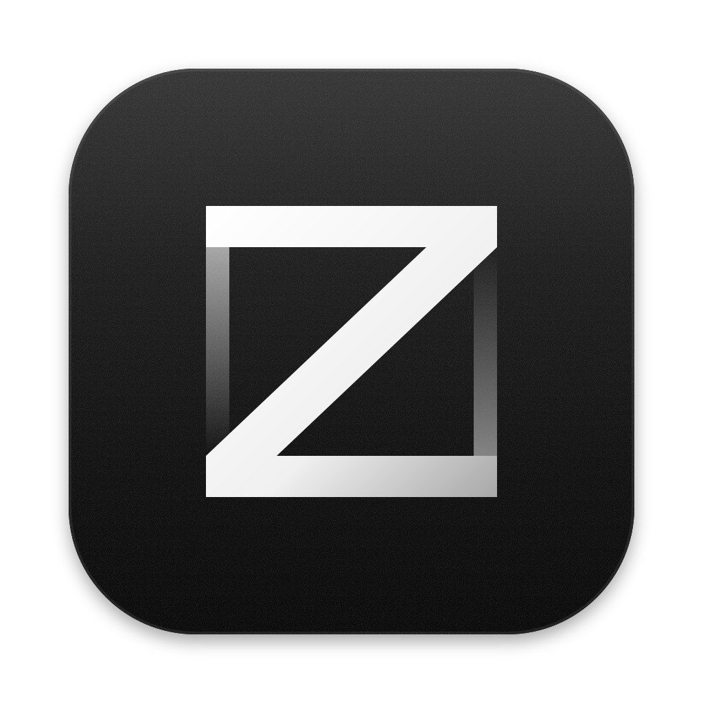
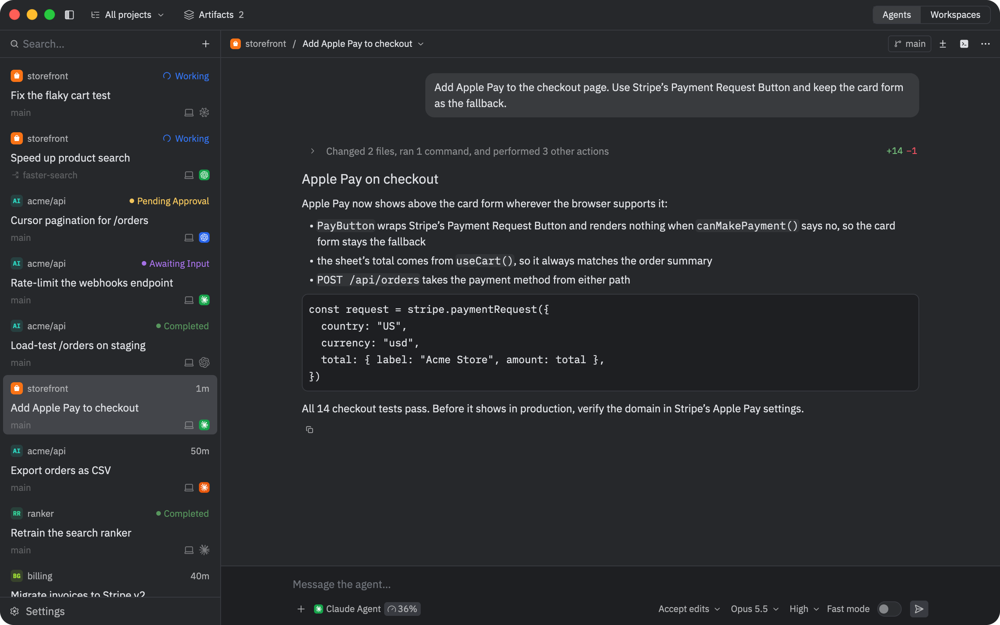

<p align="center"></p>

# agentZ

A native app for macOS and Linux for working with coding agents over the
[Agent Client Protocol](https://agentclientprotocol.com) (ACP). Run Claude Agent, Codex, Factory
Droid, Gemini CLI, OpenCode and any other ACP agent side by side, across your projects and
machines, with several accounts each and real terminals beside them. A background server on each
machine keeps the agents working while the app is closed. It is built on GPUI,
[Zed](https://zed.dev)'s UI framework.

Website: <https://ahrorbeksoft.github.io/agentZ/>



## What it does

### Agents

- **Any ACP agent.** Install and update agents from the
  [ACP Registry](https://github.com/agentclientprotocol/registry) in Settings › Agents: Claude
  Agent, Codex, Factory Droid, Gemini CLI, GitHub Copilot, Cursor, Devin, OpenCode, Amp, Grok
  Build, Google Antigravity, Qwen Code and about 30 more. Or add your own command as a custom
  agent. Log in the way each agent offers: in the browser, with an API key or a gateway, or in a
  terminal, on this computer or a remote one.
- **The agent's whole turn.** Messages, tool calls with their output, edits as diffs, the
  agent's plan, permission requests, the questions and forms it asks, images, Mermaid diagrams,
  slash commands, and the agent's models and modes.
- **A composer that keeps up.** Mention files, folders, other threads and artifacts with @, and
  paste images. Queue messages while the agent works, or steer the turn in progress. What you
  type is kept as a draft until you send it.
- **Subagents** run as subthreads you can open, follow and stop: Claude Agent's own subagents,
  Droid's tasks, and tasks one agent hands to another through agentZ.
- **Import** an agent's own past sessions as threads.

### Accounts and usage

- **Several accounts per agent.** Add more logins to Claude Agent, Codex, Factory Droid, Devin,
  Grok Build, Google Antigravity and Qoder CLI. Each account runs as its own process with its
  own login, sessions and settings, so threads on different accounts work in parallel. Pick the account for
  each new thread, or set the one new threads take. Each account's color marks its threads.
- **Usage at a glance.** agentZ reads each account's plan and limits and shows what's left: as a
  gauge in the thread's composer, on each account's card, and for every account in
  Settings › Usage, with a timeline of the windows to come. The bars are colored by pace, so you
  see whether a limit runs out before it resets.
- **Keep going at a limit.** When a turn stops at a used-up limit, continue the thread on the
  account with the most left, or let agentZ continue it by itself when the limit resets, even
  with the app closed. Codex's limit resets and Droid's Droid Core are a click away.

### Continue in another agent

A thread's menu has Continue with Another Agent. It starts a thread with another agent, or
another account of the same agent, in the same checkout, and gives it the conversation so far:
your messages, the agent's replies, the tools it used and its plan. You can preview exactly what
goes before you send, and the two threads link to each other.

### Projects, threads and checkouts

- **Every project in one sidebar.** Threads from all your projects and machines, with their
  agent, branch, machine and state: working, waiting for approval, waiting for your answer, or
  done. Pin, drag to reorder, archive and search them; titles can be generated for you.
- **A checkout per thread.** A thread works in the project's folder, in a new git worktree, or in
  a pasture: an instant copy-on-write copy of the project. Pastures sync from the project and
  bring their branch back.
- **Diffs by turn.** agentZ checkpoints the tree around every turn without touching your branches
  or index. The diff panel shows the working tree, the branch's changes, the latest turn or any
  earlier one, and reverts files.
- **Chats** are threads outside every project, for questions that aren't about one, with the
  same agents and accounts.

### Workspaces and terminals

- **The Workspaces view.** Workspaces rooted at a folder, with tabs of split panes holding
  shells, agent CLIs (Claude Code, Codex, Droid, OpenCode, Gemini CLI, Cursor and more) and agent
  threads. agentZ sees when an agent CLI is working, done or waiting for you, and tells you. Save
  a tab's layout with its commands and open it in any workspace. Worktrees group under their
  repository.
- **Real terminals** in the Workspaces view, as threads of their own, in each thread's terminal
  drawer, and live in agents' tool calls, with scrollback, find and the mouse.

### Machines

- **Remote machines over SSH.** Add a Mac or a Linux machine in Settings › Machines: agentZ
  installs its server there and keeps it updated. Its projects, threads, terminals and
  workspaces show beside this computer's.
- **One project on several machines.** Checkouts of the same repository combine into one
  project, and New Thread shows how each copy stands in git (branch, ahead and behind,
  uncommitted files) before you pick one. Agents can delegate tasks to another machine's copy.
- **Agents keep running.** Each machine's server owns its agents and terminals, so quitting the
  app or losing the connection doesn't stop them. Updating a server hands its running agents and
  terminals over to the new one.

### Artifacts and designs

Agents publish documents and designs from any thread or chat, and agentZ opens them in your
browser, in the app's theme. A document is Markdown with files to download, and exports to
Markdown or PDF. A design is a set of decisions, each with a few variants, as pictures or live
pages, beside what's there today: you pick one, take parts of others, comment, and submit, and
the agent reads your picks. Each publish is a new version. The Artifacts button lists them by
thread, and @ mentions them in any thread.

### Agent control

Every agent gets agentZ's own MCP server, and scripts and agent CLIs get the
`agentz-server call` command. With them an agent lists and reads other threads, starts threads
and sends them messages, delegates tasks to subthreads on this machine or another, opens
terminals, runs commands and adds projects. It never gets more permission than the thread that
calls it.

### Everything else

- **Skills and MCP servers** added once in Settings reach every agent and account, and each can
  be kept off some accounts.
- **Sounds and notifications** when a thread finishes or waits for you.
- **Storage** shows what agentZ keeps on each machine (threads, chats, worktrees and pastures,
  agents) and deletes what you pick.
- **The keyboard** reaches everything: the command palette (Cmd-Shift-P), Go To (Cmd-P) for
  every thread, workspace, tab and pane, and the shortcuts sheet (Cmd-/). On Linux, Ctrl stands
  for Cmd.
- **Zed's themes**: One, Ayu, Gruvbox, JetBrains and Catppuccin, light and dark.

## Install

On a Mac (Apple silicon or Intel, macOS 10.15.7 or later), in Terminal:

```sh
curl -fsSL https://ahrorbeksoft.github.io/agentZ/install.sh | sh
```

It installs `agentZ.app` in `/Applications` (or `~/Applications` when `/Applications` isn't
writable). Run it again to update. `AGENTZ_VERSION=0.1.0` installs a given release, and
`AGENTZ_APP_DIR` picks another folder.

On a Linux desktop (x86_64), the same command installs the app in `~/.local/agentz.app`, with
`agentz` in `~/.local/bin` and an entry in your applications (`AGENTZ_APP=1` installs it outside
a desktop session too). It needs Wayland or X11, Vulkan, and xkbcommon, which desktops have.

A machine you reach from the app over SSH needs nothing installed: add it under Settings ›
Machines › Add Machine, and the app installs its server there when it connects.

You can also download a build from the [releases page](https://github.com/ahrorbeksoft/agentZ/releases/latest)
and check it against `SHA256SUMS`. The app is signed ad hoc, not notarized by Apple, so a zip
downloaded with a browser is quarantined and macOS refuses to open it. Clear that once:

```sh
xattr -dr com.apple.quarantine /Applications/agentZ.app
```

### Uninstall

The server keeps running when you quit the app, so stop it first:

```sh
# macOS
/Applications/agentZ.app/Contents/MacOS/agentz-server stop
rm -rf /Applications/agentZ.app

# Linux
~/.local/agentz.app/bin/agentz-server stop
rm -rf ~/.local/agentz.app ~/.local/bin/agentz ~/.local/share/applications/dev.agentz.agentZ.desktop

# A machine the app reached over SSH
~/.agentz/server/agentz-server stop
rm -rf ~/.agentz/server
```

Your threads and settings stay in `~/Library/Application Support/agentZ/` on a Mac and
`~/.agentz/` on Linux; delete that folder too to remove everything.

## Build from source

Needs Rust (the version in `rust-toolchain.toml` installs itself through rustup). On Linux, also a
C toolchain and the libraries GPUI builds against; on Debian and Ubuntu: `build-essential cmake
clang libxkbcommon-dev libxkbcommon-x11-dev libwayland-dev libx11-xcb-dev libfontconfig-dev
libzstd-dev`.

```sh
cargo build                       # the app (target/debug/agentz) and agentz-server
tooling/bundle-mac.sh             # target/bundle/agentZ.app, a release build
tooling/bundle-linux.sh           # target/bundle/agentZ-linux-<arch>.tar.gz, on Linux
tooling/build-remote-servers.sh   # Linux servers for SSH machines (needs zig and cargo-zigbuild)
```

[`docs/architecture.md`](docs/architecture.md) maps the code: the architecture, the crates, the
data files, and where each feature lives. [`AGENTS.md`](AGENTS.md) has the conventions and how
to run and test it.

## Releases

Pushing a tag that matches the version in `Cargo.toml` (`[workspace.package]`, the app's and the
server's) publishes a release:

```sh
git tag v0.1.0
git push origin v0.1.0
```

`.github/workflows/release.yml` builds the Linux servers (static musl, x86_64 and arm64), the
universal macOS app and the x86_64 Linux app with those servers inside them, and publishes the
apps with `SHA256SUMS` as a GitHub release. The website in `site/` deploys to GitHub Pages from
`.github/workflows/pages.yml` whenever it changes on `main`. `install.sh` always fetches from
the latest release, so there's no update server.

## Credits and license

agentZ is a lean port of parts of [Zed](https://github.com/zed-industries/zed) (GPUI, the `ui`
components, themes, terminals), and takes its designs from
[t3code](https://github.com/pingdotgg/t3code), [herdr](https://github.com/ogulcancelik/herdr) and
[cow](https://github.com/joeinnes/cow), and reads some agents' usage as
[OpenUsage](https://github.com/robinebers/openusage) does. See
[`docs/architecture.md`](docs/architecture.md) for what came from where.

The app and agentZ's own crates are licensed under the GPL-3.0-or-later
([`LICENSE-GPL`](LICENSE-GPL)); the crates copied from Zed keep their own licenses, GPL-3.0 or
Apache-2.0 ([`LICENSE-APACHE`](LICENSE-APACHE)), as declared in each crate's `Cargo.toml`.
