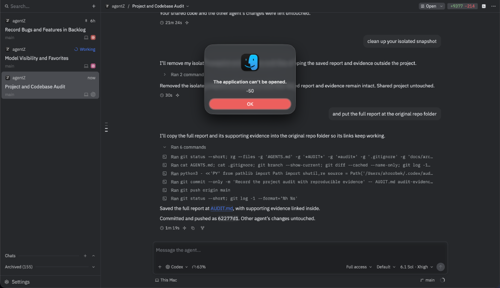

# Backlog

Features and bugs to implement, in the order they were given. Keep the user's request and any
findings with each entry. Remove an entry once it's built.

## Bugs

### Linux: Ctrl-, doesn't open Settings while a terminal has focus

On Linux, Ctrl-, does nothing while a terminal has focus; it should open Settings as it does
elsewhere.

Not reproduced yet: headless tests (`shell::tests::cmd_comma_opens_settings_while_…`) show the
binding (`secondary-,` in the `Shell` context) reaching `OpenSettings` with a terminal focused,
so the cause is likely in what a real Linux keyboard sends (xkb's key and `key_char` for the
comma while Ctrl is down). Needs a run under a real X or Wayland session.

Skipped for now (October 18, 2026). Not reproduced under X11 either: on Xvfb with no input
method, `xdotool key ctrl+comma` opened Settings with focus in a Workspaces pane, a thread's
terminal drawer and a terminal thread. Left to try: Wayland, an input method (IBus or Fcitx,
which get every key on X11 through XIM), a desktop shortcut on Ctrl-, and non-US layouts.

### Clicking a file link in a thread says "The application can't be opened"

Reported October 23, 2026: pressing a file link an agent gave opens a macOS dialog, "The
application can't be opened. -50", instead of the file. In the screenshot, it's the `AUDIT.md`
link in a Codex thread's "Saved the full report at AUDIT.md".

## Features

### Artifacts move with their thread to another machine

From the Artifacts 2 round (`design/artifacts-2/`, decided in its intro and topic 7): an
artifact moves with its thread when the thread goes on on another machine. Nothing moves a
thread to another machine yet (Continue with Another Agent, workspace handoff and the limit
notice stay on its machine), so this waits for that. Until then, a thread can't publish a new
version of another machine's artifact ("there's no artifact … to update").
