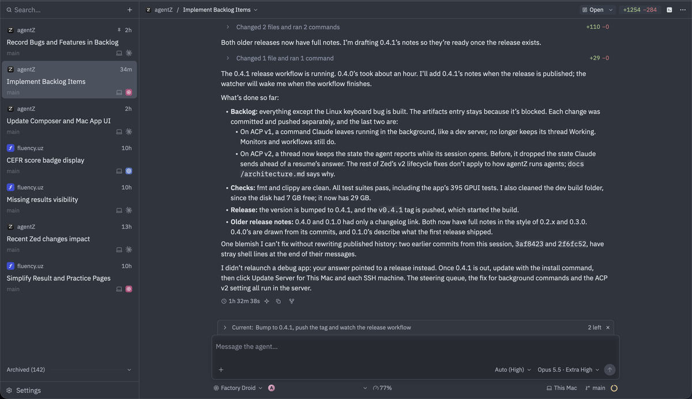
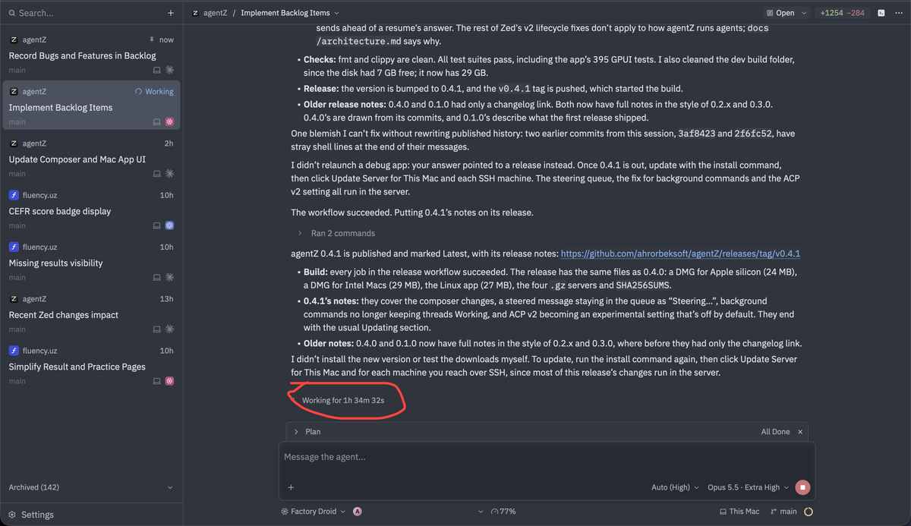

# Backlog

Features and bugs to implement, in the order they were given. Keep the user's request and any
findings with each entry. Remove an entry once it's built.

## Bugs

### Linux: Ctrl-, doesn't open Settings while a terminal has focus

On Linux, Ctrl-, does nothing while a terminal has focus; it should open Settings as it does
elsewhere.

Not reproduced yet: headless tests (`shell::tests::cmd_comma_opens_settings_while_…`) show the
binding (`secondary-,` in the `Shell` context) reaching `OpenSettings` with a terminal focused,
so the cause is likely in what a real Linux keyboard sends (xkb's key and `key_char` for the
comma while Ctrl is down). Needs a run under a real X or Wayland session.

Skipped for now (October 18, 2026). Not reproduced under X11 either: on Xvfb with no input
method, `xdotool key ctrl+comma` opened Settings with focus in a Workspaces pane, a thread's
terminal drawer and a terminal thread. Left to try: Wayland, an input method (IBus or Fcitx,
which get every key on X11 through XIM), a desktop shortcut on Ctrl-, and non-US layouts.

### Factory Droid doesn't show Working while it waits on background work

Reported October 23, 2026 as "this bug again", then: "while it is waiting, if there is a way to
find out, it should still show working, it is successfully continues it, but yeah, not showing
working, not splitting turns".

So turns no longer split, and Droid does go on once its background work ends, but while it
waits, the thread doesn't show Working. If there's a way to find out it's waiting, it should
still show Working. In the screenshot, the turn shows as ended (1h 32m 38s) right after Droid
said "The 0.4.1 release workflow is running … the watcher will wake me when the workflow
finishes", with its plan still at "Current: Bump to 0.4.1, push the tag and watch the release
workflow" (2 left).

And also, when the work is finished, it shows it's still working. In the second screenshot,
Droid has woken, published 0.4.1 and given its final answer, its plan is All Done, but the
thread still shows "Working for 1h 34m 32s" (circled), Working in the sidebar and the Stop
button.

Earlier entries on Droid's background work ("Turns split without user messages", "A message
sent while Factory Droid wakes by itself is never answered") were built in a7a4262 ("Keep
Droid's turns whole while its background work runs", in v0.4.0 and v0.4.1). The account's
email in the composer is covered in both screenshots.

## Features

### Artifacts move with their thread to another machine

From the Artifacts 2 round (`design/artifacts-2/`, decided in its intro and topic 7): an
artifact moves with its thread when the thread goes on on another machine. Nothing moves a
thread to another machine yet (Continue with Another Agent, workspace handoff and the limit
notice stay on its machine), so this waits for that. Until then, a thread can't publish a new
version of another machine's artifact ("there's no artifact … to update").

### Improve subthreads again

Requested October 23, 2026, after the subthreads redesign (09f27b1), which made it clear to
agents that they can just end their turn once they delegate:

- While subthreads are working, show the agent as still working, as if it weren't the end of
  its turn.
- When a subthread's result comes back, steer the agent with it if the agent has steering of
  its own (not agentZ's custom implementation, and only if it really exists); otherwise just
  queue it.
- On the left side, show only the running agents; done ones go inside a completed tasks button
  or something like it. If none are working, all of them can be shown.
- Users should be able to work with hundreds of subthreads, if they want to finish one whole
  project in one go.

### Improve the subagent view

Improve the subagent view: its Cancel and Open Parent buttons look bad. Maybe there shouldn't
be buttons like that at all, maybe there should; to be decided.

### Subthread templates per role, on the account with the most to spare

Requested October 23, 2026: "we have subthreads, but now agents choose the models themselves,
but i am thinking why not let users choose subthread templates like idk, they choose workers,
researchers etc per agent provider and we also introduce clever selction that (idk some kinda
system that chooses the agent/acount with the most usage for the selected subthread type or
something idk". Agreed in the conversation that followed:

Then, on the roles: "we have research, review, worker, and other. users should be able choose
for these. no agent overrides, agents see these availabe ones and use them if not or asked other
agents to do things they use those", and "call them better, researcher, reviewer, worker and
other".

- **Four roles: researcher, reviewer, worker and other.** They replace today's six
  (implementation, research, review, design, test, general: `TASK_ROLES` in
  `server/tools.rs`), which are only a label on the task's message. A task the parent gives no
  role is other.
- **The user picks what each role runs on**, per role and not per agent: an ordered list of
  agent and model (and effort or mode), e.g. Researcher: Codex · gpt-5 · high, then Claude ·
  Sonnet.
- **No agent overrides.** Agents see the four roles and the user's picks for them
  (`orchestrator_capabilities`), and delegate by role. They name an agent or model themselves
  only when the role has no pick, or when the user asked for other agents to do the work; then
  they use those. (That's my reading of "use them if not or asked other agents to do things
  they use those".)
- **The account is picked for the user, the agent isn't.** Vendors' limits can't be compared
  (Claude's 40% left isn't Codex's), so the role's list orders the agents. Within an agent,
  skip accounts logged out or used up, and prefer the one that would waste the most at its
  reset (60% left resetting in an hour before 80% left resetting in 6 days), from the
  projection the limit rows already make (`usage_limits::pace`). When all of an agent's
  accounts are used up, go to the role's next entry.
- **Left out for now:** moving a running subthread to another account when it reaches its
  limit mid-turn, and roles beyond the four.
- Neither Zed nor t3code has this. It's a settings change (likely beside Subthreads at once in
  Settings › General › Threads), so it starts on the design board.
