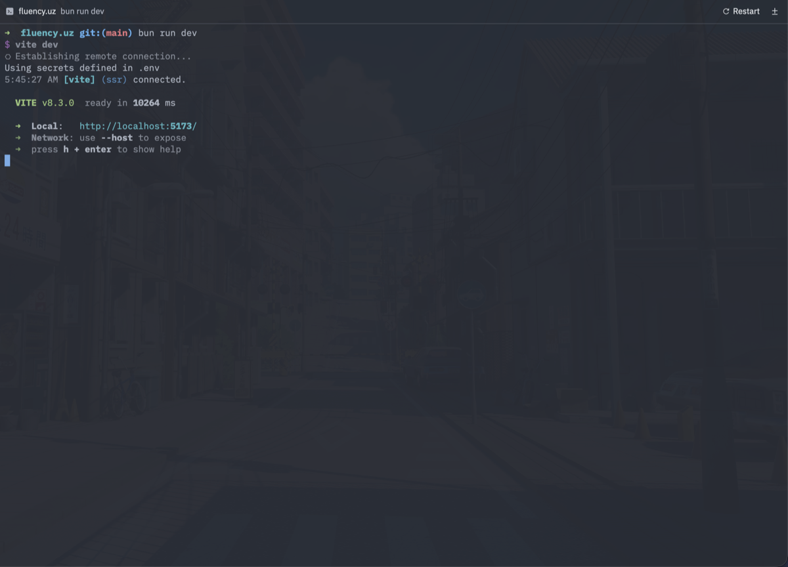
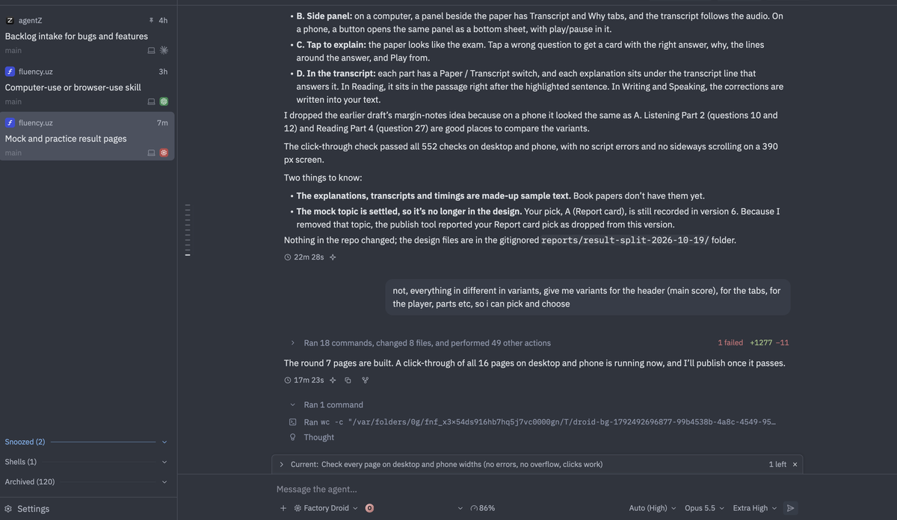
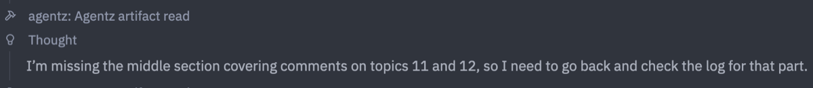
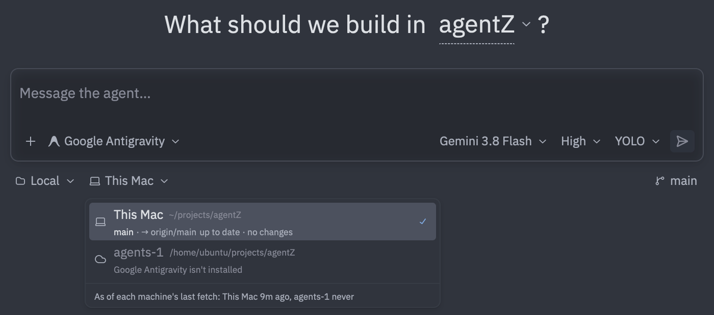

# Backlog

Features and bugs to implement, in the order they were given. Keep the user's request and any
findings with each entry. Remove an entry once it's built.

## Bugs

### Linux: Ctrl-, doesn't open Settings while a terminal has focus

On Linux, Ctrl-, does nothing while a terminal has focus; it should open Settings as it does
elsewhere.

Not reproduced yet: headless tests (`shell::tests::cmd_comma_opens_settings_while_…`) show the
binding (`secondary-,` in the `Shell` context) reaching `OpenSettings` with a terminal focused,
so the cause is likely in what a real Linux keyboard sends (xkb's key and `key_char` for the
comma while Ctrl is down). Needs a run under a real X or Wayland session.

Skipped for now (October 18, 2026). Not reproduced under X11 either: on Xvfb with no input
method, `xdotool key ctrl+comma` opened Settings with focus in a Workspaces pane, a thread's
terminal drawer and a terminal thread. Left to try: Wayland, an input method (IBus or Fcitx,
which get every key on X11 through XIM), a desktop shortcut on Ctrl-, and non-US layouts.

### Links in terminals aren't clickable

In any terminal, links aren't clickable, and the mouse pointer is an I-beam (text cursor) all
the time, even over a link (here `http://localhost:5173/` from `vite dev`).

### Turns split without user messages

Still the same issue: turns are splitting without user messages. In the screenshot (Factory
Droid), one turn ends ("The round 7 pages are built…", 17m 23s) and the next starts below it
("Ran 1 command", "Thought") with no user message between them.

The account's email in the composer is covered in the screenshot.

### Claude's background dev server keeps its thread Working

Requested October 21, 2026: "sometimes claude runs a background task and forget about it and
it shows it is still working … like a dev server". Asked whether to follow t3code, the user
said: "t3-code implement their own thing we use acp, we gotta find acp way of doing".

Findings, from "Mock and practice result pages" (thread 535), local time:

- Claude started `bun run dev --port 5188` in the background at 00:00 on October 20 and
  finished its turn at 00:24:33. The thread stayed Working until the user stopped the server
  from the background-task panel at 00:46:08 (Claude's record: "stopped by the user").
- Any running background task counts as reported work (`is_reported` in `AgentThread`'s
  `OwnWorkQuiet` handling), which is waited for with no limit. While it runs, the machine is
  also kept awake, the agent isn't stopped when idle, and the finished sound waits. This was
  built for bug 3 of `design/feedback/plan.md`: a build Claude said it would wait for.
- The ACP way is v2's `state_update` session update. The agent reports its foreground work as
  `running`, `requires_action` and `idle`, including work it starts by itself, "for example
  to … follow up on a completed background task". Background activity goes on while `idle`
  and doesn't change it. So a dev server leaves the thread idle, and Claude's follow-up once a
  task ends shows as running. Claude Agent 0.94.0 sends these on v2 (`v2Foreground` in its
  `dist/v2/prompt.js`), with its own model cycles after a background subagent as work of their
  own. Codex ACP 2.2.2 has `state_update` too (not read in detail).
- v1 has no state for a session, only for subagent sessions (`StateUpdate`, unstable). There
  the prompt's answer is the only end of foreground work the agent reports, and what agentZ
  does after it is inference.
- For comparison, t3code doesn't let background commands hold a thread, but does let
  subagents and monitors hold it (`backgroundWorkHoldsCompletion`).

Waits for "Use reported ACP v2 state with a fallback for inferred activity" below, which waits
until Zed enables ACP v2. Still to decide: what agents without v2 state do meanwhile.

### Factory Droid's background subagents are forgotten after its first report

Requested October 21, 2026: "droid spuns agents but they never kept track of while the main
agent is waiting for them, it shows it's done".

Findings, from "Migrating mobile UI to React Native…" (thread 547, a fluency.uz thread),
October 21, local time:

- At 00:15 Droid sent three workers to the background (Task with `await: false`) and ended
  its turn. The thread rightly stayed Working.
- At 00:27 one reported, Droid woke and sent another off, and at 00:29 agentZ marked the
  thread Completed with three still running. After that, each report showed Working for about
  a minute, then Completed. The worker Droid started at 01:00 was never waited for.
- From 00:59 to 01:00 agentZ ended a wake halfway: Droid sent nothing for about 45 seconds
  while it wrote its next Task call.
- Causes, in `agent_thread.rs`: `detached_subagents` is one flag for all of them, cleared by
  any update during the wait ("The agent woke, with the subagents' reports"). It's set only
  when a prompt's answer arrives (`turn_goes_on_in_background`), so a Task sent off during a
  wake isn't counted. Once it's cleared, 30 seconds without updates (`OWN_WORK_QUIET`) ends
  the work.
- A background Task's row says "In the background" for good. Droid writes "Background task
  completed. task_id: …" only into its session file (`~/.factory/sessions/<cwd>/<session>.jsonl`),
  not over ACP, so agentZ can't tell which worker ended. Each worker is a Droid session of its
  own, its id the task_id, in a file beside it.
- The mock's `droid-task background` runs one subagent and is stopped. Nothing tests a wake
  with a report, several subagents, or one sent off during a wake.

Possible fix: track each background Task by the task_id in its launch notice, including those
started during a wake, count each wake as one report (in thread 547 Droid woke once per
report), and keep the 20-minute give-up. Reading the notices from Droid's session file would
be exact, but reads Droid's files. On v2 Droid would report its wakes itself, but Droid 0.245.0
only speaks v1 (it answers `initialize` for version 2 with 1). A change to the row goes
through the design board.

### Factory Droid's background commands aren't waited for

Found October 21, 2026, behind the report in the next entry: Droid had woken by itself, and
agentZ didn't know it would.

Findings, from "Mock and practice result pages" (thread 535), October 20, local time: at 15:39
Droid ended its turn with "Run round 7 click-through" left running (an Execute with
`fireAndForget`, answered "Background process started (PID: …)"), and agentZ marked the thread
Completed. At 16:08:51 the command finished and Droid woke by itself. Waiting after a turn
counts only Claude's background tasks (AIR's `asyncTasks`) and Droid's background Tasks, not
this.

Possible fix: treat such an Execute the way a background subagent is treated, and keep the thread
Working until the command ends. The server runs on the agent's machine, so it can check that
the PID is still alive.

### A message sent while Factory Droid wakes by itself is never answered

Requested October 21, 2026: "sometimes i am seeing not stopping after finishing everyting it
shows working".

Findings, from the same thread (535), October 20, local time:

- Droid woke at 16:08:51, when its background command finished (entry above), but its first
  update reached agentZ only at 16:10:39. At 16:09:40 the user sent "are you here?" while the
  thread looked idle, so agentZ sent it as a prompt.
- Droid folded it into the work it was doing, as steering ("A follow-up user message arrived
  while you were working"), answered "Yes, I'm here", and finished at 16:19:23. It never
  answered the prompt.
- The thread stayed Working until the user pressed Stop at 19:03 (server log: "Factory Droid
  didn't answer the stop of its turn in 5s; restarting it"). Only a stopped turn has a timeout
  (`STOP_TIMEOUT`, `end_unanswered_turn`).
- The same can happen whenever Droid wakes while agentZ shows it idle, for example after a
  background subagent agentZ stopped waiting for (entries above).

Not verified: the raw ACP messages weren't captured. This comes from Droid's session file,
agentZ's transcript (`transcripts/535.json`) and the server log, which agree. It can't be
reproduced with the real Droid, since that means sending it prompts; the mock's `lost-turn`
loses a turn as Droid does.

### Factory Droid threads don't get an automatic title

Auto title generation is not working on Droid, but Regenerate Title renames the thread
correctly. Maybe enable it for every agent when it's enabled in the settings.

### An agent misses the middle of an artifact it read

Given as a screenshot only: after an `agentz_artifact_read` call (shown as "agentz: Agentz
artifact read"), the agent thought "I'm missing the middle section covering comments on topics
11 and 12, so I need to go back and check the log for that part."

## Features

### Artifacts move with their thread to another machine

From the Artifacts 2 round (`design/artifacts-2/`, decided in its intro and topic 7): an
artifact moves with its thread when the thread goes on on another machine. Nothing moves a
thread to another machine yet (Continue with Another Agent, workspace handoff and the limit
notice stay on its machine), so this waits for that. Until then, a thread can't publish a new
version of another machine's artifact ("there's no artifact … to update").

### Smaller release downloads

The release downloads are too big: 101 MB for macOS and 47 MB for Linux (v0.3.0). Bring them
down.

Findings (October 19, 2026), measured from v0.3.0's assets and release builds on this Mac:

- Most of each download is servers. The macOS zip has the universal app (41 MB compressed),
  the universal server (21 MB), the same two Mac servers again one per chip in `Resources`
  (21 MB, an exact duplicate) and both Linux servers (21 MB). The Linux tarball has the app
  (27 MB), its server (11 MB) and the arm64 Linux server (10 MB).
- One download per platform, each with only its own app and server (zip/tar.gz as now):
  Apple silicon 29.7 MB, Intel 32.1 MB, Linux x86_64 38.0 MB, Linux arm64 about 36 MB (no
  Linux arm64 app is built yet; estimated). An SSH machine of another kind would then need its
  server downloaded, for example from the release, as Zed downloads its remote server.
- xz in place of deflate takes a third off with no code change: Apple silicon 20.0 MB, Linux
  x86_64 about 26 MB. On macOS that would be a DMG with LZMA compression, as Zed ships a DMG
  (not measured); on Linux `.tar.xz`. `site/install.sh` changes with either.
- Build settings, Apple silicon, xz, app + server + icon: fat LTO 19.2 MB; fat LTO with
  `opt-level = "s"` 16.0 MB (the code is slower; likely fine for the server, untried for the
  app's drawing and terminals); plus `panic = "abort"` 13.5 MB, but a panic in any server task
  would then end the whole server and every running turn, so not for the server.
- In the app, Mermaid rendering (`merman`, Zed's feature) is about 8 MB of its 42.6 MB. Unused
  image formats (exr, tiff, dds, …) are about 0.5 MB per binary; the two crypto libraries
  (aws-lc, ring) under 1 MB together.

Suggested: one download per platform, xz/DMG, fat LTO and `opt-level = "s"` for the server
(about 18 MB for Apple silicon), then try `"s"` on the app.

### Annotate an image opened from the composer

Image annotation when an image is opened from the input composer.

### Warn agents that give pictures instead of live pages

Maybe warn agents when they give pictures instead of live pages. A setting, global or per
project (the project's setting overrides the global one), decides whether they're warned that
this is happening.

### Redesign the thread composer

Redesign the composer in threads.

### Show whether an agent or account is in use, and every agent's usage

When picking agents or accounts, show an indicator of whether each is being used (whether
it's working). Also show usage for agents with a single account: the usage percentage is
shown only for accounts, not for agents.

### Redesign subthreads

Redesign subthreads. This time they should look something like worktrees in Workspaces.

- Give agents more control over them, but also good defaults, so they can split work up
  easily.
- Agents should be able to stop while waiting for a subthread's results.
- Improve the messages the user sees from agents: for example, hide the default instructions,
  maybe make them collapsible.
- Improve the results side too: maybe make it look like a tool call. To be figured out.

### Redesign the machine selector

The machine selector under a new thread's composer needs improving: it looks ugly.

Also, another machine can't be chosen when the selected agent isn't installed there (above,
"Google Antigravity isn't installed" on agents-1). But what if the user uses two different
agents on two machines? How would they do that then?

### A close button for terminals in the Agents tab

Terminals in the Agents tab need a close button (not the terminals in threads).

## Zed upstream updates

Requested October 18, 2026: add all five groups from the upstream review. The review compared
our October 1 Zed reference (`57bfce2945`) with upstream through October 17 (`56934ec056`),
245 newer commits. These are source findings; the failures have not been reproduced in agentZ.

### Follow Zed's v2 session lifecycle

agentZ is on SDK 3.4.0, as upstream is
([#65706](https://github.com/zed-industries/zed/pull/65706)); the update needed no code
changes, and agentZ still initializes with protocol v1. Session notices and context compaction
are built.

Waits until Zed enables ACP v2: the user's rule is not to enable it before Zed does. As of
these PRs, Zed's v2 backend is built but inactive ("an unselected v2 backend").

Follow Zed's developing v2 session lifecycle, including resume/replay and metadata handling:
[#65698](https://github.com/zed-industries/zed/pull/65698) and
[#65709](https://github.com/zed-industries/zed/pull/65709). Treat this as a deliberate protocol
update, separate from the smaller copied-crate fixes. Test with the mock agent.

For all copied-crate updates, preserve agentZ's Metal drawable handling, nested scrolling,
Markdown image rendering and link chips, and animation frame limits, documented under
Crates in `docs/architecture.md`.

## Approved upstream features and replacements

Requested October 18, 2026: support all of the following, with fallbacks where necessary.
Choose native capabilities when the agent supports them, and retain the existing path for
agents that do not. This explicitly authorizes agent and platform capability fallbacks; the
app and its machine servers still update together. Coordinate the ACP work with the SDK and
protocol update above. Verify behavior with the mock agent; installed adapters' support has
not been verified.

### Use reported ACP v2 state with a fallback for inferred activity

Waits until Zed enables ACP v2, as the v2 session lifecycle above does.

Use explicit state updates for foreground activity when available, replacing the matching
inference about autonomous work starting and ending
([state contract](https://github.com/agentclientprotocol/rust-sdk/blob/v3.4.0/md/protocol-v2.md)).
Keep the existing inference for agents without those reports and keep background work tracked
separately: v2 idle describes foreground state and does not mean all work ended. Preserve
steering and AIR functionality where agents still provide them only on v1.
